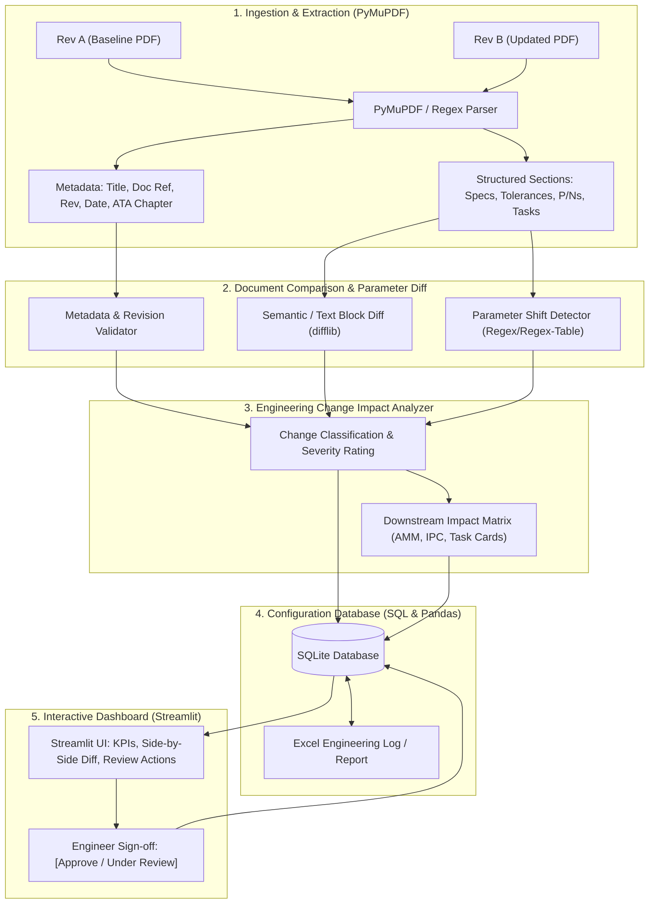

# ✈️ Aircraft Technical Documentation & Engineering Change Impact Analysis System

[](https://www.python.org/)
[](https://streamlit.io/)
[](https://pymupdf.readthedocs.io/)
[](LICENSE)

An intelligent, safety-conscious decision-support system designed for aerospace engineers, airlines, and MRO (Maintenance, Repair, and Overhaul) facilities. The system automates the ingestion, comparison, tolerance shift analysis, and downstream maintenance tracking of revised OEM aircraft technical publications (such as Airbus/Boeing **Aircraft Maintenance Manuals (AMM)** and **Service Bulletins (SB)**).

---

## 📌 The Problem It Solves

When an OEM (e.g., Airbus or Boeing) releases a revision for an aircraft component manual, technical engineers must manually cross-examine dozens of pages to answer:
1. **What has changed?** (e.g., Hydraulic pump rated pressure increased from `3000 PSI` to `3200 PSI`; torque updated from `120 in-lbs` to `135 in-lbs`; part number superseded from `P/N 9400-A` to `P/N 9400-B`).
2. **Which component is affected?** (Component ID, ATA Chapter, Aircraft MSN applicability).
3. **What downstream documentation is impacted?** (AMM task cards, line tooling calibration, Illustrated Parts Catalog IPC, Maintenance Planning Document MPD intervals).
4. **Is configuration tracking maintained systematically?** (Tracking fleet components through revision states with human-in-the-loop engineer sign-offs).

> ⚠️ **Aerospace Safety Rule**: This application acts as a deterministic decision-support tool that flags and highlights changes for certified engineering review; it does **not** independently certify an aircraft as airworthy.

---

## 🚀 Key Features & Enterprise Modules

* **Feature 1: PyMuPDF Extraction Engine**: Coordinate-aware and regex-assisted parsing of PDF headers, Document Reference IDs, Revision numbers, Publication dates, ATA chapters, Component metadata, and structured specification tables.
* **Feature 2: High-Precision Document Comparison**: Text sequence matching coupled with numerical parameter shift detection (`PSI`, `bar`, `in-lbs`, `ft-lbs`, `°C`, `Flight Hours`, and `P/N`), calculating signed delta shifts ($\Delta$).
* **Feature 3: Visual PDF Annotator (Highlight Bounding Boxes)**: PyMuPDF dynamically scans and draws native color-coded highlight boxes directly onto the PDF document pages (green for additions, amber for modifications, red for baselines) for side-by-side visual inspection.
* **Feature 4: OEM Part Interchangeability Engine**: Automatically evaluates part supersession rules:
  * **Class 1 (Two-Way)**: Fully interchangeable in both directions (normal stock attrition).
  * **Class 2 (One-Way)**: New P/N can replace Old P/N, but Old P/N CANNOT replace New P/N. Quarantines old warehouse stock to prevent component overpressure.
  * **Class 3 (Non-Interchangeable)**: Requires structural or electrical modification.
* **Feature 5: Airline Fleet MSN & Tail Number Effectivity**: Matches document applicability against airline fleet rosters (MSN, aircraft models, flight hours, cycles) to determine which specific tail numbers are affected vs exempt.
* **Feature 6: Multi-System Ripple Effect (Knowledge Graph)**: Uses topological directed graphs (NetworkX) to visualize how upstream power changes (e.g., ATA 29 Hydraulic pump pressure) ripple into downstream consumers (Landing Gear, Brakes, Flap/Slat control units, Cargo doors).
* **Feature 7: AI Semantic Engineering Rationale & Directives**: Synthesizes engineering justifications, shop-floor technician directives (tooling/relief valve calibration), and FAA 14 CFR Part 43 / EASA Part 145 regulatory statements.
* **Feature 8: Live Regulatory Feed (FAA & EASA ADs)**: Ingests and cross-references Airworthiness Directives with active fleet components.
* **Feature 9: Interactive Streamlit Dashboard & Excel Reporting**: Complete multi-tab engineering portal with human-in-the-loop review sign-offs and styled multi-sheet Excel reports (`openpyxl`).
* **Feature 10: AeroCopilot (Technical Manual RAG Engine)**: Ingests manuals into semantic chunks, vectorizes via TF-IDF / Cosine Similarity, and provides conversational Q&A with grounded document citations, section titles, and similarity confidence scores.
* **Feature 11: Legacy & Military Scanned Document OCR Pipeline**: Automatically detects rasterized scans, performs PIL image preprocessing (grayscale, contrast boost, sharpening), and extracts vintage military technical orders (e.g. C-130 T.O.s).
* **Feature 12: Enterprise MRO / Airline ERP Synchronization Hub**: Formats approved changes into ATA SPEC 2000 compliant Engineering Change Orders (ECOs) with cryptographic SHA-256 signatures, dispatching to Swiss-AS AMOS, SAP S/4HANA Aviation, or IBM Maximo REST webhooks.

---

## 🏗️ Architecture & Data Flow



---

## 📂 Project Structure

```text
aircraft-doc-analysis/
│
├── .gitignore                     # Git exclusions (__pycache__, DBs, temp exports)
├── requirements.txt               # Dependencies (streamlit, pymupdf, pandas, openpyxl, reportlab)
├── README.md                      # Complete system documentation
├── app.py                         # Streamlit Interactive Dashboard
│
├── data/
│   ├── sample_pdfs/               # Baseline and revision test documents
│   │   ├── AMM_29_10_00_Rev01.pdf # ATA 29 Hydraulic Pump (Rev 01)
│   │   ├── AMM_29_10_00_Rev02.pdf # ATA 29 Hydraulic Pump (Rev 02)
│   │   ├── SB_A320_32_1420_Rev01.pdf # ATA 32 Landing Gear (Rev 01)
│   │   └── SB_A320_32_1420_Rev02.pdf # ATA 32 Landing Gear (Rev 02)
│   ├── generate_sample_pdfs.py    # Script to generate synthetic Airbus-style PDFs
│   ├── fleet_inventory.db         # SQLite configuration database
│   └── export/                    # Directory for exported Excel reports
│
├── src/
│   ├── __init__.py
│   ├── extractor.py               # PyMuPDF metadata & technical content extraction
│   ├── diff_engine.py             # Numerical tolerance delta & text diff engine
│   ├── impact_analyzer.py         # Severity scoring & downstream document impact matrix
│   ├── db_manager.py              # SQLite configuration management & review audit trail
│   └── excel_exporter.py          # Styled multi-tab Excel report generator
│
└── tests/
    └── test_pipeline.py           # Automated test pipeline verifying all modules
```

---

## ⚡ Quickstart Guide

### 1. Clone the Repository
```bash
git clone https://github.com/aakritishakya9/aircraft-doc-analysis.git
cd aircraft-doc-analysis
```

### 2. Install Dependencies
```bash
pip install -r requirements.txt
```

### 3. Generate Sample Aviation PDFs & Run Automated Tests
```bash
python tests/test_pipeline.py
```

### 4. Launch the Streamlit Dashboard
```bash
python -m streamlit run app.py
```
Open your browser at `http://localhost:8501`.

---

## 🧪 Testing with Real Aviation Data

In addition to the synthetic Airbus documents included in `data/sample_pdfs/`, you can test with public aviation authority documents:
* **[FAA Airworthiness Directives (ADs)](https://www.faa.gov/aircraft/air_cert/airworthiness_directives/)**: Free public regulatory safety directives.
* **[EASA Airworthiness Directives](https://www.easa.europa.eu/en/document-library/airworthiness-directives)**: European Union aviation safety publications.
* **[NTSB Investigation Reports](https://www.ntsb.gov/investigations/Pages/default.aspx)**: Detailed incident analyses referencing component part numbers and revision histories.

---

## 📄 License
This project is open-source under the MIT License.
